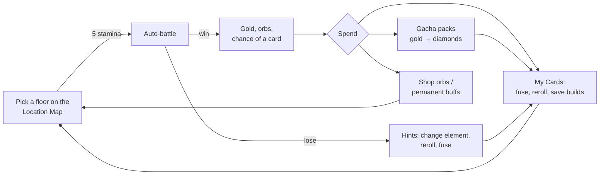

# AniGame: Game Design Document

| | |
|---|---|
| **Genre** | Single-player card battler / auto-battler with gacha-style progression |
| **Engine** | Unity 6000.2.15f1, URP, uGUI |
| **Platform** | Windows (current build). Other platforms: **TBD** |
| **Players** | 1, offline |
| **Status** | Playable vertical slice: all 9 screens, full campaign data, full rule set |
| **Last verified** | 2026-11-24 against commit `53e815d` + working tree |

---

## 1. Pitch

**You are the card.** Make a character (your own name, your own picture) and climb 100 anime-themed locations,
beating one character from a different anime on each floor. You never collect other characters. You collect
*copies of yourself* at different rarities, and fuse them to raise your one card from **Common** to **God**.

Every win pays gold. Gold buys packs, orbs and rerolls. Each reroll is a gamble on your card's stats, element or
talent. Permanent buffs gradually tilt the odds toward you.

## 2. Design pillars

*Inferred from the current build. Confirm or replace them.*

1. **One card, many decisions.** Depth comes from upgrading a single card: rarity, four stat rolls, element,
   talent, and three saved builds. You never manage a 30-card deck.
2. **Readable auto-battles.** Fights resolve on their own, then play back with anime-style effects, damage
   numbers and a full battle log, so you can see *why* you won or lost.
3. **Gambling without real money.** Fusion, rerolls and packs are all random, but both currencies are earned
   in play. Diamonds come only from gold packs. Permanent buffs soften bad luck, but there is no pity counter.
4. **A long climb.** 100 locations, ~2,350 floors, 9 rarities. The final rarity (God) is locked behind a
   late-game buff.

## 3. Player character

- Created on first launch (`Assets/Scripts/UI/CharacterScreen.cs`): a name (1–20 characters) and a picture,
  either imported from the PC (a file, path or URL) or picked from the built-in anime portraits.
- **The character is the only one you collect** (user rule, 15 Nov 2026). Every card you own, whether it came
  from a pack, a floor drop or your starter, shows your character's name and art.
  Cards differ only in rarity and build (`Assets/Scripts/Data/PlayerProfile.cs:17`).
- You can change the name and picture at any time. All your cards update with it.

## 4. Core loop

**Moment to moment:** choose a floor and a build slot, press FIGHT, watch the battle at 1×/2×/4× speed, collect
the rewards, then retry or move to the next floor.

**Session:** stamina caps a session at about 16 fights (80 stamina ÷ 5 per fight), plus the stamina you earn
back from first clears, Elixir and location clears. It refills at 1 point every 5 minutes. Between sessions,
the player spends what they earned in My Cards, Gacha, Shop and Buffs.

**Long term:** clear locations in order (each one unlocks the next and refills stamina), raise your card's
rarity, and buy permanent buffs. The New Generation buff unlocks the God rarity.

## 5. Progression

| Axis | Range | Driven by | Details |
|---|---|---|---|
| Card rarity | Common → God (9 tiers) | Fusion: main card + 2 same-rarity copies + Fusion Orbs | [fusion-and-rerolls.md](design/fusion-and-rerolls.md) |
| Card build | 4 stat rolls, element, talent | Gold rerolls, Element Orbs, Talent Orbs | [cards-and-rarity.md](design/cards-and-rarity.md) |
| God power | +0% → +20% all stats | God Orbs (50% success each) | [fusion-and-rerolls.md](design/fusion-and-rerolls.md#god-orb) |
| Campaign | LOC 1 → 100 | Clearing every floor of a location | [campaign.md](design/campaign.md) |
| Account | 22 permanent buffs | Gold and diamonds | [buffs.md](design/buffs.md) |
| Build slots | 1 → 3 | Diamonds (0 / 300 / 600) | [cards-and-rarity.md](design/cards-and-rarity.md#build-slots) |

Rarity raises every stat by 5% per tier (God = +40%), widens the stat roll range, and makes the talent up to
20% stronger. Enemy power rises steadily from 100 at LOC 1 to 1,090 at LOC 100. See the
[difficulty curve](design/campaign.md#difficulty-curve).

## 6. Systems summary

| System | In one paragraph | Spec |
|---|---|---|
| **Combat** | 1v1, turn-based, fully automatic. The faster card acts first each round. Each turn: status effects → passive talent → active talent (if mana is full) → normal attack → mana gain. Both fighters enrage from round 20 (+10% ATK each round). Round 50 ends in a draw. | [combat.md](design/combat.md) |
| **Elements** | 9 elements. A five-element cycle (Fire > Tree > Rock > Lightning > Water > Fire), Dark ⇄ Light, and two special elements, Neutral and Non-Neutral. Advantage is ±25%, same element is −12.5%. | [elements.md](design/elements.md) |
| **Talents** | 38 talents, each card has one. Active talents fire when the mana bar is full; passive talents trigger on battle start, turn start, or after attacking. Talent strength scales with rarity. | [talents.md](design/talents.md) |
| **Fusion** | Main card + 2 fodder of the same rarity + Fusion Orbs → +1 rarity. Success falls from 100% (Common) to 15% (Mythic → God). On a fail, the orbs and the fodder are lost. | [fusion-and-rerolls.md](design/fusion-and-rerolls.md) |
| **Rerolls** | Gold rerolls all 4 stats. An Element or Talent Orb (or its gold price) rerolls the element or talent. The result is a preview until you save it to a slot. | [fusion-and-rerolls.md](design/fusion-and-rerolls.md#rerolls) |
| **Economy** | Gold (from fights) and diamonds (from gold packs only). Four orb types. Gold Cashback, Golden Touch and discount buffs. | [economy-and-stamina.md](design/economy-and-stamina.md) |
| **Gacha** | 3 gold packs and 3 diamond packs, 5 items each. Slot 1 is always a card of the pack's rarity. No pity. | [gacha-packs.md](design/gacha-packs.md) |
| **Buffs** | 22 permanent upgrades in 4 groups (Fusion, Collection, Economy, Combat). Each is bought once and kept forever. | [buffs.md](design/buffs.md) |
| **Stamina** | Max 80, each fight costs 5, +1 every 5 minutes. Refunds for first clears, location clears and some buffs. | [economy-and-stamina.md](design/economy-and-stamina.md#stamina) |
| **Campaign** | 100 locations, each themed on one anime, 12–36 floors per location. Floors unlock in order. | [campaign.md](design/campaign.md) |

## 7. Screens

Main Menu · Character · Location Map · My Cards (Collection) · Gacha · Shop · Buffs · Library · Battle.
Flow and purpose: [ux/screens-and-flow.md](ux/screens-and-flow.md).

## 8. Content in the current build

| Content | Count | Source |
|---|---|---|
| Locations | 100 | `Assets/Data/campaign.csv` |
| Floors (enemy cards) | 2,358 | `Assets/Data/campaign.csv` |
| Anime series | 82 | `ANIME` column |
| Talents | 38 (25 active, 13 passive) | `Assets/Scripts/Talents/` |
| Permanent buffs | 22 | `Assets/Scripts/Rules/Buffs.cs` |
| Gacha packs | 6 | `Assets/Scripts/Rules/Packs.cs` |
| Rarities / elements | 9 / 9 | `CardRarity.cs`, `CardElement.cs` |
| Sound effects | 21, synthesised at runtime | `Assets/Scripts/Audio/SfxSynth.cs` |
| Music | 3 slots (menu, battle, gacha), empty by default | `Assets/Art/UserArt/Audio/` |

## 9. Monetisation

**None in the current build.** Gold and diamonds are both earned through play, and nothing is sold for real
money. Whether that stays true is **TBD**.

## 10. Audience, platform and release

**TBD.** The code doesn't say who the game is for, which platforms beyond Windows are planned, or whether a
public release is planned. Section 11 matters before any public release.

## 11. Content and IP notes

Write these down honestly now, so nobody mistakes them for original content later:

- **Characters and art.** Every campaign enemy is a real anime character. The sheet links portraits hosted on
  MyAnimeList and AniList (`IMAGE` column). The generator downloads them into `Assets/Campaign/Images/`, and
  `RemoteImageCache` downloads missing ones at runtime.
- **Mechanics.** The rules are modelled on the community game *Anigame* (a Discord card bot), and code
  comments say so: "Anigame rule", "like Anigame raid bosses". The damage formula comes from a community
  Anigame calculator (`Assets/Scripts/Battle/BattleEngine.cs:327-330`), and the status-effect numbers follow
  Anigame talent texts (`Assets/Scripts/Battle/StatusEffects.cs:4-9`). Even the name "AniGame" is close.
- Before any public release you would need to replace the characters and portraits with original or licensed
  ones, and choose a distinct name.

## 12. Decision log

Collected from dated or attributed code comments. Decisions from the original design doc are the defaults
everywhere else.

| Date | Decision | Where |
|---|---|---|
| — | One card type: every stat has a base of 100 | `Assets/Scripts/Rules/GameRules.cs:12` |
| — | Every talent can appear at every rarity. Talent strength grows up to +20% at God | `Assets/Scripts/Rules/GameRules.cs:32` |
| — | Extra Fusion Orbs no longer raise the fusion success rate | `Assets/Scripts/Rules/GameRules.cs:43` |
| — | God Orb: works only on God cards, can fail, is never sold | `Assets/Scripts/Rules/GameRules.cs:80` |
| — | Floor enemies use the sheet's stats unchanged (the POWER column already scales them) | `Assets/Scripts/Rules/GameRules.cs:91` |
| — | Burn halved to 5% per stack and capped at 4 stacks (at 10%, Blaze won 76% of even fights) | `Assets/Scripts/Battle/StatusEffects.cs:7` |
| — | Regeneration capped at 3 stacks (uncapped stacks caused most timed-out draws) | `Assets/Scripts/Talents/Active/Regeneration.cs:7` |
| 15 Nov 2026 | Stamina rules: max 80, 5 per fight, +1 every 5 minutes, +2 on a first clear, refill when a location unlocks | `Assets/Scripts/Rules/GameRules.cs:70` |
| 15 Nov 2026 | The list of 22 permanent buffs and their mixed gold/diamond prices | `Assets/Scripts/Rules/Buffs.cs:18` |
| 15 Nov 2026 | Your own character is the only character you can collect | `Assets/Scripts/Data/PlayerProfile.cs:17` |

## 13. Open design questions

See [project/roadmap.md](project/roadmap.md#open-design-questions).
