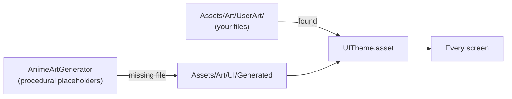

# Art and audio guide

**Source of truth:** `Assets/Art/UserArt/README.txt` (exact file names and sizes), `Assets/Scripts/UI/UITheme.cs`,
`Assets/Editor/AnimeArtGenerator.cs`, `Assets/Scripts/UI/CardFrame.cs`, `Assets/Scripts/UI/AnimeBackground.cs`,
`Assets/Scripts/UI/Fx/`, `Assets/Scripts/Audio/`

## Visual direction

*Inferred from the current build. Confirm or replace it.*

- **Anime / gacha UI:** dark backgrounds with saturated accent colours, pink-purple highlights, drifting sakura
  petals, halftone dots, light rays and manga speed lines.
- **Rarity is the loudest visual signal.** Every rarity has its own colour and frame, and the effects grow with
  rarity ([below](#rarity-frames)). God frames get an animated rainbow tint.
- **Element colours** are fixed and appear everywhere (badges, damage numbers, the chart). See
  [elements.md](../design/elements.md#the-9-elements).
- **Everything moves:** scene wipes, panels sliding in, buttons that bob and breathe, screen shake and slow
  motion on big hits.

## How art gets into the game

1. Put a file with the **exact name** listed in `Assets/Art/UserArt/README.txt` into the right subfolder.
2. Run **Tools › AniGame › Steps › 4. Generate UI Art** (or Build Everything).
3. Any slot you didn't fill keeps a generated placeholder. All art references live in one asset,
   `Assets/Resources/UITheme.asset` (44 slots).

**Use PNG for every icon.** Unity's legacy `Text` can't show colour emoji.

### Replaceable art

Full list and file names: `Assets/Art/UserArt/README.txt`. This is a summary, not a copy.

| Folder | Count | Size | Notes |
|---|---|---|---|
| `Backgrounds/` | 6 (menu, map, battle, cards, gacha, shop) | 1920×1080, opaque | |
| `Frames/` | 9, one per rarity | 512×716, transparent centre | 9-slice border of 128 px. God frames should be light or white, because the game tints them |
| `Elements/` | 9 | 256×256 round badges | |
| `Icons/` | 8 (gold, diamond, 4 orbs, stamina, lock) | 256×256 | |
| `Talents/` | 38 | 256×256 | Shown on cards instead of the talent name |
| `Buffs/` | 22 | 256×256 | |
| `Packs/` | 6 | 512×720 | Gacha pack covers |
| `Effects/` | 6, optional | various | Sakura petal, sparkle, halftone, light rays, speed lines, frame shine |
| `logo.png` | 1 | 1200×400, transparent | Main menu |

### Rarity frames

From `Assets/Scripts/UI/CardFrame.cs`. Effects add up as rarity rises:

| Rarity | Extra effect |
|---|---|
| Common – Rare | Coloured frame only |
| Super Rare + | A glow pulsing behind the card |
| Legendary + | A band of light sweeping across the art |
| Mythic + | Twinkling sparkles. The Mythic glow shifts between cyan and magenta |
| God | Animated rainbow tint on the frame |

### Character portraits

- **Campaign portraits** are downloaded from the sheet's `IMAGE` URLs into `Assets/Campaign/Images/` and
  imported as single compressed sprites, at most 512 px (`CampaignImagePostprocessor`). Portraits that are
  still missing are downloaded at runtime and cached in `persistentDataPath/image_cache` (`RemoteImageCache`).
- **The player's portrait** is either imported (centre-cropped to the card art shape and saved as
  `character_portrait.png` in `persistentDataPath`) or one of the campaign portraits (`gallery:KEY`).
- These portraits belong to third parties. See [GDD §11](../GDD.md#11-content-and-ip-notes).

## Motion and effects

| Module | What it does |
|---|---|
| `Fx/ScreenFader` | Scene transition: a slanted pink and purple panel wipes across, the scene loads, the panel wipes away |
| `Fx/ScreenIntroRunner` | The new screen's panels slide and fade in |
| `Fx/UIFx` | Effects created at runtime: sparks, confetti, rings, slashes, light bursts, glows, wind streaks, text slams, screen flashes, afterimages, shakes, zoom punches, pop-ins, slow motion |
| `Fx/FxBob`, `FxBreathe`, `FxSpin`, `FxShaker`, `FxTween`, `FxParticles` | Small reusable motion components |
| `AnimeBackground` | Animated background (runs on unscaled time, so slow motion doesn't affect it) |
| `DamagePopup` | Damage numbers in battle, coloured by damage type |

Effects are created at runtime, so screens don't need a scene rebuild to get new effects.

## Audio

### Music

`Assets/Scripts/Audio/MusicPlayer.cs`: three slots in `UITheme` (**menu**, **battle**, **gacha**), filled from
`Assets/Art/UserArt/Audio/` (`.ogg`, `.mp3` or `.wav`, loopable). The player is created automatically, survives
scene loads, and cross-fades between tracks. **No music ships by default**, so the game is silent until you
add the files.

### Sound effects

`Assets/Scripts/Audio/SfxSynth.cs`: **21 sound effects synthesised in code**, so no audio files are needed. Each
clip is generated the first time it plays. You can replace any of them by assigning a real `AudioClip` in
`SfxSynth.overrides`.

| Group | Ids |
|---|---|
| UI | `click`, `whoosh`, `swoosh`, `coin`, `sparkle` |
| Combat | `swing`, `hit`, `crit`, `miss`, `impact`, `slash`, `charge`, `skill` |
| Status | `heal`, `buff`, `burn`, `poison`, `stun` |
| Results | `win`, `lose`, `fail` |

SFX volume is saved in the save file (`sfxVolume`, default 0.7).

## Open art and audio questions

- Final art style and logo: **TBD**. Everything is currently procedural placeholder art unless a `UserArt`
  file exists.
- Music: **TBD** (three loopable tracks needed).
- Original or licensed character art before any public release: **TBD**.
