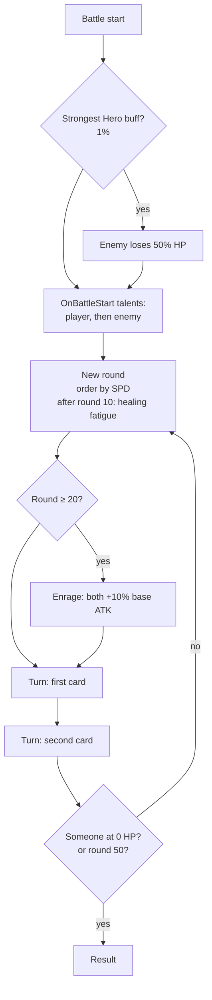

# Combat

**Source of truth:** `Assets/Scripts/Battle/BattleEngine.cs`, `Assets/Scripts/Battle/StatusEffects.cs`,
`Assets/Scripts/Card/CardRuntime.cs`, `Assets/Scripts/UI/BattleScreen.cs`

Combat is a fully automatic **1v1** fight between your active build slot and the floor's enemy. The engine is
pure C#: it computes each turn instantly and records events, and `BattleScreen` plays those events back with
animations. See [architecture](../tech/architecture.md#battle-engine).

## Battle flow



### Turn order

Each round, the card with the higher **SPD** acts first. **Ties go to the player.** Order is recalculated every
round, because talents change speed (`BattleEngine.cs:144`).

### One turn

`BattleEngine.ExecuteTurn`:

1. **Status effects** (`StatusEffects.ProcessStatusEffects`), in this order: Regeneration heal → Burn damage →
   Poison damage (each Burn / Poison tick can miss, and a miss removes every stack) → barrier, immunity, Silence
   and Endurance countdowns → Stun / Freeze / Sleep check. A stunned, frozen or sleeping card skips the rest of
   the turn.
2. **Turn-start talent** (`OnTurnStart`): most passive talents act here.
3. **Active talent**, if the card has one, is not silenced, and has `mana ≥ max(manaCost, maxMana)` (in
   practice, a full bar; Celestial Blessing only needs its own cost). The mana is spent and the talent fires.
   A card with several actives takes turns between them, skipping any that can't be cast any more.
4. **Normal attack.** It always happens, even after a talent fires.
5. **Mana gain** (below).
6. **Timed buffs tick down** (for example Divine Blessing).

### Mana

From `BattleEngine.cs:260`:

| Event | Mana |
|---|---|
| End of your turn, no talent used | `ceil(80 / round) + 20`, × Mana Regen % |
| End of your turn, talent used | 10, × Mana Regen % |
| You are hit by a normal attack | +5 |
| You evade an attack | +5 |

Round 1 gives 100, so an active talent normally fires on the card's **second turn** (later if the enemy
lowered its Mana Regen). After that the bar refills
more slowly: 60 in round 2, 47 in round 3, 40 in round 4, 28 in round 10. Mana Regen starts at 100%, and
Celestial Blessing and Celestial Influence change it.

Things that change the turn mana (the "× Mana Regen %" rows):

| Effect | Mana Regen |
|---|---|
| **Silence** (passive) on the enemy, after you cast | 0 for the rest of that turn and your next 2 turns |
| Your **Burst Barrier** is up | −50% |
| The enemy is asleep from your **Sleep** | −50% |

Mana from being hit or evading (+5) is never changed.

## Normal attack

`BattleEngine.NormalAttack`:

1. Attacker's `OnBeforeAttack` talent hook.
2. **Evasion:** the defender dodges with a chance equal to its evasion %. A dodge deals no damage and gives the
   defender +5 mana. Skill damage (Elemental Strike, Dexterity Drive, Life Sap…) can only be dodged by a card with
   **Counter Stance**, which also strikes back after every dodge.
3. **Damage** from the formula below, including the element multiplier and crit.
4. **Sleep:** attacks don't wake a sleeping defender, but normal attacks on it deal −30%.
5. **Endurance:** if the defender has it, the damage is cut (45% with the current asset), and 35% of the blocked
   amount is reflected to the attacker as true damage. The 35% scales with talent power.
6. Defender's `OnTakeDamage` talent hook.
7. The damage is applied: first the percent reduction (`damageTakenReduction`), then the flat reduction
   (`damageReduction`), minimum 1. A **barrier** (Burst Barrier) absorbs it first; what it can't hold goes on to
   the HP, then the broken barrier explodes on the attacker. This holds for every kind of damage, true damage too.
8. Reflect, then **lifesteal** (the attacker heals `lifesteal %` of the damage dealt).
9. The defender gains +5 mana. Then the attacker's `OnAfterAttack` hook runs.

### Damage formula

From the community Anigame calculator, `BattleEngine.cs:327-350`:

```
damage = (100 × baseATK × currentATK + 638,000) / (87 × DEF)
       × element multiplier
       × (critDamage / 100)   if the crit roll succeeds
```

- `baseATK` is the card's ATK at the start of battle; `currentATK` includes every buff and debuff. ATK
  increases count twice through the product, so ATK buffs are strong.
- The flat 638,000 means even very low ATK still hurts low-DEF targets.
- Every hit deals at least 1 damage.

**Talent damage** that says "X% of a stat" is `stat × X × 10`, so it is on the same ×10 scale as HP
(`DamageCalculator.FromStat`). "Elemental" talent damage then applies the element multiplier.

### Damage types

| Type | Reduced by DEF | Reduced by damage reduction | Examples |
|---|---|---|---|
| Normal / Critical | yes (formula) | yes | Normal attacks |
| Skill | no (already computed) | yes | Elemental Strike, Berserk Strike, Life Sap |
| True | no | no | Balancing Strike, Vengeance, Mana Reaver, Burn, Poison, Endurance reflect, recoil |

## Status effects

From `Assets/Scripts/Battle/StatusEffects.cs`:

| Effect | Applied by | Effect each turn | Lasts |
|---|---|---|---|
| **Burn** | Blaze | 5% max HP true damage per stack (max 5 stacks); healing received −85%. Each tick can miss: 10% with one stack, +5% per extra stack; **a miss removes every stack** | Until it misses or is removed |
| **Poison** | Poison | 5 + 5% max HP true damage per stack. Each tick can miss: 15% with one stack, +5% per extra stack; **a miss removes every stack** | Until it misses or is removed |
| **Stun** | Paralysis | Skip the next turn. **DEF −10% permanently** (base DEF too) | 1 turn |
| **Sleep** | Sleep | Skip turns, can't evade; attacks don't wake it, normal attacks on it −30%; the caster's Mana Regen −50% | 2 turns |
| **Silence** | Restricted Instinct | Can't use the active talent; max mana capped at 100 | 2 turns (scales) |
| **No Mana Regen** | Silence (passive) | No Mana Regeneration after casting an active | That turn + 2 turns |
| **Barrier** | Burst Barrier | Absorbs damage first (excess goes through), explodes when broken; owner's Mana Regen −50% | 3 turns |
| **Regeneration** | Regeneration | Heal 5% max HP per stack (max 3 stacks). Each tick can fail: 10% with one stack, +10% per extra stack; a failed tick heals nothing and removes one stack | Until the stacks run out |
| **Endurance** | Endurance | Normal attacks −45%, reflect 35% of the blocked damage | 3 turns |
| **Timed buff** | Divine Blessing | +ATK% / +DEF% of base | 5 turns |

The numbers in this table are the current values on the talent assets; [talents.md](talents.md) and
`Docs/talents.csv` list them all.

Percentages marked as scaling grow with the caster's [talent power](talents.md#rarity-scaling).

## Ending a battle

| Condition | Engine result | Shown as | Rewards |
|---|---|---|---|
| Enemy at 0 HP | PlayerWon | VICTORY / FLOOR CLEARED | Full victory rewards |
| Player at 0 HP | EnemyWon | DEFEAT | Returning Heroes stamina only |
| Both at 0 HP in the same action | Draw | **Counted as a victory** (`BattleScreen.cs:209`) | Full victory rewards |
| Round 50 reached | Draw | TIME UP (a defeat) | Returning Heroes stamina only |

- **Enrage:** from round **20**, at the start of every round, both living fighters gain +10% of base ATK. It
  stacks, so long fights end quickly (`BattleEngine.cs:31-32`).
- **Healing fatigue:** after round **10**, all healing received drops by 5% more every round (−50% in round 20,
  none from round 30), so healing talents can't stall forever (`GameRules.HealingMultiplier`,
  `GameBalance.asset`).
- **Second Wind** (buff): the first time the player would die, a 1% chance to stand back up with 1 HP.
- After a defeat, the result screen suggests a counter element and the next upgrade to try.

## Speed and randomness

- Playback speed is **1×, 2× or 4×**, saved in the save file (`battleSpeed`). Auto-battles keep running when
  the window loses focus (Run In Background is enabled by the setup tool).
- Battle randomness goes through `BattleRandom` and can be seeded (`new BattleEngine(player, enemy, seed)`),
  which makes balance simulations repeatable.
