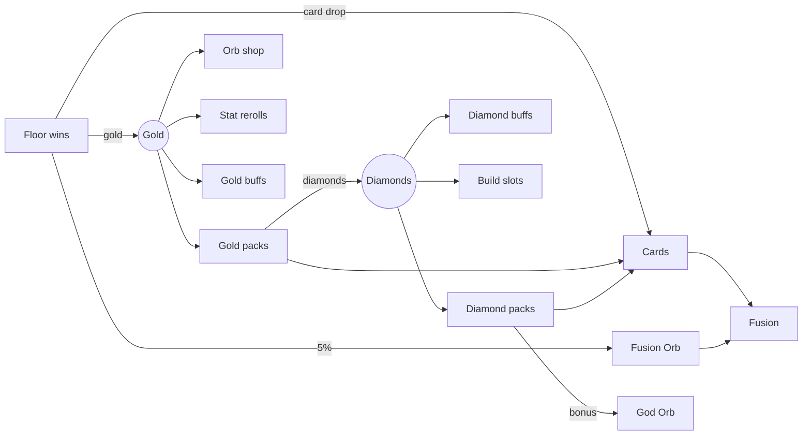

# Economy and stamina

**Source of truth:** `Assets/Scripts/Rules/GameRules.cs`, `Assets/Scripts/Data/PlayerProfile.cs`,
`Assets/Scripts/Rules/Packs.cs`, `Assets/Scripts/Rules/Buffs.cs`

## Currencies

| Currency | Start | Comes from | Spent on |
|---|---|---|---|
| **Gold** | 3,000 | Every floor win, gold pack items, diamond pack items, dismantling, Gold Cashback | Gold packs, orb shop, stat rerolls, element/talent rerolls without an orb, gold buffs |
| **Diamonds** | 0 | **Gold packs only** (doc 7.1), plus Treasure Hunter loot | Diamond packs, diamond buffs, build slots 2–3 |
| **Fusion Orb** | 2 | 5% chance per win, packs, shop (1,000 gold), Treasure Hunter, Lucky Fusion refunds | Fusion |
| **Element Orb** | 0 | Packs, shop (3,500 gold), Treasure Hunter | Element reroll |
| **Talent Orb** | 0 | Packs, shop (7,000 gold), Treasure Hunter | Talent reroll |
| **God Orb** | 0 | 10% per win against a God enemy, diamond pack bonus | God Orb on a God card. **Never sold** |
| **Stamina** | 80 | Regeneration and refunds ([below](#stamina)) | 5 per fight |

## Battle rewards

From `PlayerProfile.ApplyVictory` (`PlayerProfile.cs:1119`). Every win pays out, not just the first clear of a
floor.

| Reward | Amount / chance | Notes |
|---|---|---|
| Gold | **20 × LOC + 5 × floor** | ×1.1 with Golden Touch. LOC 1 floor 1 = 25; LOC 50 floor 10 = 1,050; LOC 100 floor 36 = 2,180 |
| Card | By enemy rarity: 12% (Common) … 1% (Legendary, Mythic), God never | +10 points with Hunter's Instinct. The card is **your character** at the enemy's rarity, with the **enemy's talent and element** and random rolls |
| Fusion Orb | 5% | |
| Treasure (buff) | 5% with Treasure Hunter | 40% Fusion Orb, 25% Element Orb, 15% Talent Orb, 20% 10 diamonds |
| God Orb | 10% | God-rarity enemies only |
| Stamina | +2 on a first clear | +2 more with Elixir on any win. Clearing a location's last floor refills stamina to max |

**Rare Encounter** (buff): 3% chance any card you get, from a drop or a pack, comes one rarity higher. It only
upgrades cards below Ultra Rare, so the best result is Ultra Rare.

On defeat (including TIME UP) you get nothing, except +1 stamina with Returning Heroes.

## Orb shop

From `GameRules.cs:61-63`. Bought with gold, in any quantity.

| Orb | Price | With Merchant's Favor (−5%) |
|---|---|---|
| Fusion Orb | 1,000 | 950 |
| Element Orb | 3,500 | 3,325 |
| Talent Orb | 7,000 | 6,650 |
| God Orb | not sold | — |

## Gold modifiers

| Buff | Effect | Code |
|---|---|---|
| Golden Touch | +10% on all gold **earned** (wins, pack gold, dismantling) | `PlayerProfile.EarnGold` |
| Gold Cashback | 15% of all gold **spent** comes back immediately | `PlayerProfile.SpendGold` |
| Merchant's Favor | −5% on the orb shop | `PlayerProfile.OrbShopPrice` |
| Efficient Upgrader | −10% on stat rerolls, and on gold-paid element/talent rerolls | `PlayerProfile.StatRerollPrice` |

## Diamond income

Diamonds only come from gold packs (and Treasure Hunter). Expected diamonds per pack = 4 rolled slots × chance
× amount (`PackDefinition.ExpectedDiamonds`):

| Gold pack | Price | Expected diamonds | Diamonds per 1,000 gold |
|---|---|---|---|
| Common | 1,000 | 0.8 | 0.8 |
| Rare | 3,000 | 4.8 | 1.6 |
| Super Rare | 10,000 | 24 | 2.4 |

So the cheapest diamond pack (100 diamonds) costs about **42,000 gold** of Super Rare packs, or 125,000 gold of
Common packs, before counting the other items in them. Full odds: [gacha-packs.md](gacha-packs.md).

## Stamina

From `GameRules.cs:70-75` (user rules, 15 Nov 2026) and `PlayerProfile.cs:1013-1068`.

| Rule | Value | Buff |
|---|---|---|
| Max stamina | 80 | **Potion of Stamina**: 100 |
| Cost per fight | 5 | — |
| Regeneration | +1 every 5 minutes | **Stamina Master**: +2 every 5 minutes |
| First clear of a floor | +2 | — |
| Any win | — | **Elixir**: +2 |
| Defeat | — | **Returning Heroes**: +1 |
| Clearing a location (unlocks the next) | Refill to max | — |

- Stamina is spent when you press FIGHT on the map, or RETRY on the battle screen.
- A full bar is 16 fights. Refilling from empty takes **6 h 40 min** (3 h 20 min with Stamina Master).
- Regeneration is calculated from a saved timestamp, so it continues while the game is closed. It stops at
  max, and gains can't push stamina above max.
