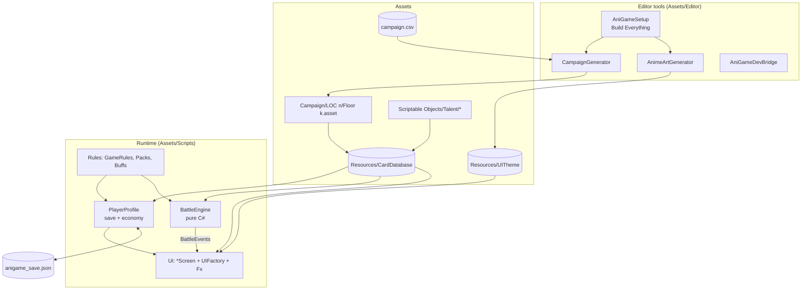

# Technical architecture

**Source of truth:** `Assets/Scripts/**`, `Assets/Editor/**`

## Overview

- **Unity 6000.2.15f1**, URP 17.2, uGUI, Input System 1.16.
- **No assembly definitions.** Game code compiles into `Assembly-CSharp` and editor tools into
  `Assembly-CSharp-Editor`. There are no namespaces, so every type is global.
- **Static services, no dependency injection.** `PlayerProfile`, `GameSession`, `GameRules`, `Packs`, `Buffs` and
  `ElementSystem` are static classes. `CardDatabase` and `UITheme` are ScriptableObject singletons loaded from
  `Resources/`.
- **Data first:** every balance number lives in `Assets/Scripts/Rules/` and nowhere else.

## Folder responsibilities

| Folder | Responsibility | Depends on |
|---|---|---|
| `Scripts/Rules/` | Balance numbers and tables (`GameRules`, `Packs`, `Buffs`) | Nothing (enums only) |
| `Scripts/Card/` | `Card` asset (character data), enums, `CardRuntime` (a fighter in battle), `Talent` base classes | Rules |
| `Scripts/Talents/` | One class per talent | Card, Battle |
| `Scripts/Battle/` | `BattleEngine`, `DamageCalculator`, `ElementSystem`, `StatusEffects`, `BattleLog`/`BattleEvent`, `BattleRandom` | Card, Rules |
| `Scripts/Data/` | `PlayerProfile` (save, currencies, fusion, rerolls, packs, stamina, rewards), `CardDatabase`, `SaveTransfer`, `CharacterPortrait`, `FileDialogs` | Rules, Card, Battle |
| `Scripts/UI/` | One `*Screen` per scene, widgets, `UIFactory`, `UITheme`, `Fx/` | Everything above |
| `Scripts/Audio/` | `MusicPlayer` (auto-created), `SfxSynth` (procedural) | UITheme |
| `Editor/` | Setup pipeline, generators, importer, Dev Bridge | Everything |

## Battle engine

From `Assets/Scripts/Battle/BattleEngine.cs`. Rules: [combat.md](../design/combat.md).

- `BattleEngine` is a **pure C# class**: no MonoBehaviour, no timing. `Begin()` runs the battle-start talents.
  Each `Step()` runs **exactly one card's turn** and adds `BattleEvent`s to `Events`. `RunToEnd()` finishes the
  whole battle instantly (used by the simulator and by `BattleSystem`).
- Each `BattleEvent` stores a **snapshot of both fighters' HP and mana** taken right after it happened.
  `BattleScreen` plays the events back one at a time with animations, so the bars always match the popups.
- `BattleLog` is attached to the engine while a step runs. Talents call `BattleLog.Info/Status`, and HP changes
  inside `CardRuntime` report themselves, so talents never need a reference to the engine.
- Randomness goes through `BattleRandom` (`BattleLog.cs:130`), which is seeded from the engine's constructor.
  That makes simulations repeatable.
- Talent hooks run inside `RunTalent`, which catches and logs exceptions. A broken talent can't freeze a battle.
- `Begin(runPlayerStart, runEnemyStart)` supports **relay battles** (a new player card joining a fight already in
  progress). `BattleScreen` doesn't use this yet ([known issues](../project/roadmap.md#known-issues)).
- `BattleSystem` + `BattleSystemTest` are a legacy MonoBehaviour wrapper for quick fights in the console.

## Cards: data and runtime

| Type | What | Lifetime |
|---|---|---|
| `Card` (ScriptableObject) | A campaign character: name, art, sheet stats, talent, location/floor, anime, image URL | Asset |
| `CardInstance` + `BuildData` | An owned copy of your character: rarity, rolls, element, talent name, God bonus, lock | Save file |
| `BuildSlot` | Slot unlock state, card uid, its own `BuildData` | Save file |
| `CardRuntime` | A fighter during one battle: current stats, mana, statuses, talent state | One battle |

- `CardRuntime(Card)` builds an enemy from sheet stats. `CardRuntime.ForBuild(instance, build)` builds the
  player from the formulas in `CardStats`/`GameRules`.
- The player's art and name come from `PlayerProfile.CharacterCard`, a runtime `Card` that is never saved.

## Talents

- Talents are **ScriptableObjects shared by every card** that uses them. **Never keep per-battle state in
  fields.** Use `CardRuntime.GetTalentState/SetTalentState` (`Talent.cs:5`).
- `ActiveTalent.Activate` fires when mana is full. `PassiveTalent` overrides the hooks it needs
  (`OnBattleStart`, `OnTurnStart`, `OnBeforeAttack`, `OnAfterAttack`, `OnTakeDamage`).
- Every number goes through `Scaled()` so it grows with rarity (`Talent.cs`).
- The assets live in `Assets/Scriptable Objects/Talent/`. **Build Everything › Repair Talent Assets** creates
  any missing ones and fills empty names and descriptions from `DefaultName` / `DefaultDescription`.
- Cards store a talent **by name**. `CardDatabase.FindTalent` matches the display name, asset name or class name,
  ignoring spaces, underscores and case.

## Player profile and saving

`PlayerProfile` holds the save (`SaveData`) and is the **only code that changes it**. Every action is a method
that returns `null` on success or an error sentence for the UI (`"Needs 3 Fusion Orbs"`). Most actions end
with `Save()`, which raises the `Changed` event so the UI can refresh. Format and protection:
[save-format.md](save-format.md).

## UI

- Scenes are **built by code**: `AniGameSetup.BuildScenes` uses `UIFactory` to create real uGUI objects and wire
  each `*Screen`'s serialized fields. Rebuilding a scene **overwrites manual edits**, so change the builder
  rather than the scene.
- `UIFactory` is also used at runtime for dynamic content (floor tiles, collection grid, popups).
- Scene changes go through `GameSession.LoadScene` → `ScreenFader`. Data passed between scenes, such as the
  pending battle, lives in `GameSession`.
- `MusicPlayer` and `ScreenFader` create themselves through `[RuntimeInitializeOnLoadMethod]`.
- Text uses legacy `UnityEngine.UI.Text`, not TextMeshPro, so icons must be sprites.

## Rules the code must keep

| Rule | Why | Where |
|---|---|---|
| Balance numbers live only in `Scripts/Rules/` | One place to tune; the Library reads them live | `GameRules.cs:4` |
| Enum values (`CardElement`, `CardRarity`, …) are append-only | Stored as integers in assets and saves | `CardElement.cs:5` |
| Buff ids are never renamed | Stored in saves | `Buffs.cs:24` |
| No per-battle state in talent fields | Talents are shared ScriptableObjects | `Talent.cs:5` |
| Every HP change goes through `TakeDamage` / `TakeTrueDamage` / `Heal` | The battle log and UI depend on it | `CardRuntime.cs` |
| Only `PlayerProfile` changes `SaveData`, and it calls `Save()` after | Integrity hash, UI refresh | `PlayerProfile.cs` |
| Change the scene builder, not the generated scenes | Rebuilds overwrite scenes | `AniGameSetup.cs` |

## Testing

There is **no automated test suite**. The Unity Test Framework package is installed but has no tests. Current
checks:

- **Tools › AniGame › Simulate Balance**: a seeded batch of simulated battles (see
  [editor-tools.md](editor-tools.md#simulate-balance)).
- **Tools › Debug Talents** and the `BattleSystemTest` component for quick fights.
- **Dev Bridge** commands for compiling, building and taking screenshots without the editor open
  ([editor-tools.md](editor-tools.md#dev-bridge)).

The battle engine is pure C# and seedable, so it is the best place to start adding tests
([roadmap](../project/roadmap.md)).
