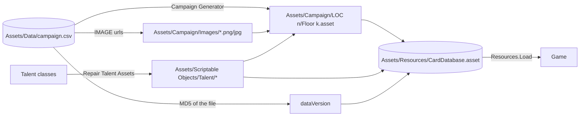

# Data pipeline

**Source of truth:** `Assets/Editor/CampaignGenerator.cs`, `Assets/Editor/AniGameSetup.cs`,
`Assets/Editor/CardImporter.cs`, `Assets/Scripts/Data/CardDatabase.cs`

## Campaign sheet

`Assets/Data/campaign.csv` (UTF-8, comma separated, one header row).

| Column | Required | Meaning |
|---|---|---|
| `LOC` | yes | Location number, 1–100 |
| `FLOOR` | yes | Letter + tier: `A1`, `B1` … `A2` … Floors are ordered by tier, then letter |
| `CARD` (or `NAME`) | yes | Character name |
| `RARITY` | yes | `Common` … `God` (`Super Rare` / `SuperRare` both work). Unknown values become Common, with a warning |
| `HP`, `ATK`, `DEF`, `SPEED` (or `SPD`) | yes | Whole numbers. HP is stored ×10 on the card |
| `ANIME` (or `SERIES`) | no | Series name. The most common one in a location names that location |
| `IMAGE` (or `IMG`) | no | Portrait URL, downloaded by the generator |
| `TALENT` | no | Talent name, matched loosely (`Amplifier_ATK` = `Amplifier ATK` = `AmplifierATK`) |
| `POWER` | no | Stored for display; the game uses the stats themselves |
| `ELEMENT` | no | Without it, the element comes from a hash of the name ([elements.md](../design/elements.md#campaign-enemies)) |
| `CRIT` / `CRITRATE`, `CRITDMG` / `CRITDAMAGE`, `EVASION` / `EVA` | no | Defaults: 5, 135, 5 |

Columns can be in any order, and headers are matched without regard to case.

### Validation

Run **Tools › AniGame › Campaign › Validate Sheet Only** to check the sheet without changing anything.

| Errors (block generation) | Warnings |
|---|---|
| A required column is missing | FLOOR isn't letter + number (sheet order is kept) |
| LOC isn't a positive number | A LOC number has no rows (the campaign stops before it) |
| CARD is empty | A location mixes several anime |
| HP/ATK/DEF/SPEED aren't whole numbers | Unknown rarity (→ Common), talent or element |
| The same floor code appears twice in one location | No IMAGE URL |

### Generating

**Tools › AniGame › Campaign › Generate From Sheet** (or **Build Everything**):

1. Parses and validates the sheet.
2. Downloads missing portraits (6 at a time) into `Assets/Campaign/Images/`. **Generate Without Downloading
   Images** skips this step.
3. Creates or updates `Assets/Campaign/LOC n/Floor k.asset`. Existing assets are **updated in place**, so GUIDs
   and references survive.
4. **Deletes stale assets**: floors beyond the sheet's count, and whole locations that are no longer in it.
5. Writes `Assets/Resources/CardDatabase.asset`: locations → floors, every talent asset, and `dataVersion` =
   **MD5 of the sheet file**.
6. Writes a report to the Console and to `Logs/AniGame_Report.txt`.

> **Any change to `campaign.csv`, even whitespace, changes `dataVersion`, and that resets every player's save**
> on the next launch (the old save is backed up). See [save-format.md](save-format.md#versioning-and-resets).

### Legacy sheet

`Assets/Data/cards.csv` → `Assets/Cards/` (through `CardImporter`, **Tools › Card Importer** or **Steps › 2**) is
the older pipeline. Build Everything uses it only when `campaign.csv` is missing. `Assets/CardData_Example.csv`
is an even older example format. Both are candidates for removal ([roadmap](../project/roadmap.md#cleanup)).

## How-to recipes

### Change a balance number

1. Find it in `Assets/Scripts/Rules/GameRules.cs`, `Packs.cs`, `Buffs.cs`, or `Battle/ElementSystem.cs`.
2. Change it. The in-game Library updates automatically.
3. Update the matching table in `Docs/design/`.
4. Run **Simulate Balance** if it affects combat.

### Add or edit a campaign enemy

1. Edit `Assets/Data/campaign.csv`.
2. Run **Validate Sheet Only**, then **Generate From Sheet**.
3. Remember that this resets saves (above).

### Add a talent

1. Create `Assets/Scripts/Talents/Active/MyTalent.cs` (or `Passive/`) that inherits from `ActiveTalent` or
   `PassiveTalent`. Copy an existing talent of the same kind as a template, for example `Active/Evasion.cs`.
2. Add `[CreateAssetMenu(menuName = "Talents/Active/MyTalent")]`.
3. Override `DefaultName` and `DefaultDescription`. Build the description from the fields so it always matches.
4. Put every number through `Scaled(value, self)` so it grows with rarity.
5. **Never store per-battle state in fields.** Use `self.GetTalentState / SetTalentState`.
6. Change HP only through `TakeDamage`, `TakeTrueDamage` and `Heal`. Log with `BattleLog.Info/Status`.
7. Run **Tools › AniGame › Steps › 1. Repair Talent Assets**. It creates the asset in
   `Assets/Scriptable Objects/Talent/`.
8. Rebuild the database (Steps › 3, or Generate From Sheet) so Talent Orbs and new cards can roll it.
9. Optional: add `talent_mytalent.png` to `Assets/Art/UserArt/Talents/` and run **Generate UI Art**.
10. Add a row to [talents.md](../design/talents.md).

### Add a gacha pack

1. Add a `PackDefinition` to `Packs.All` in `Assets/Scripts/Rules/Packs.cs`. Use a new unique `id`, and make
   the entry chances add up to 100.
2. For a God Orb bonus, add the id to `GameRules.GodOrbPackChance`.
3. Optional cover art: `Assets/Art/UserArt/Packs/pack_<id>.png`.
4. Update [gacha-packs.md](../design/gacha-packs.md).

### Add a permanent buff

1. Add a `const string` id to `Buffs` (lowercase snake_case). **It is saved, so it can never be renamed.**
2. Add the effect numbers as constants, and a `BuffDefinition` to `Buffs.All`.
3. Apply the effect where it belongs: usually `PlayerProfile.cs` (economy, rewards, fusion), or
   `PlayerProfile.ApplyCombatBuffs` plus `BattleEngine` (combat).
4. Optional icon: `Assets/Art/UserArt/Buffs/buff_<id>.png`.
5. Update [buffs.md](../design/buffs.md).

### Add an element

Add it **at the end** of `CardElement` (values are saved as integers). Then update `ElementSystem`: `All`,
`OrbWeights` (keep the total at 100), `GetElementMultiplier`, `ShortName` and `GetColor`. Add art in
`UserArt/Elements/` and update [elements.md](../design/elements.md).
