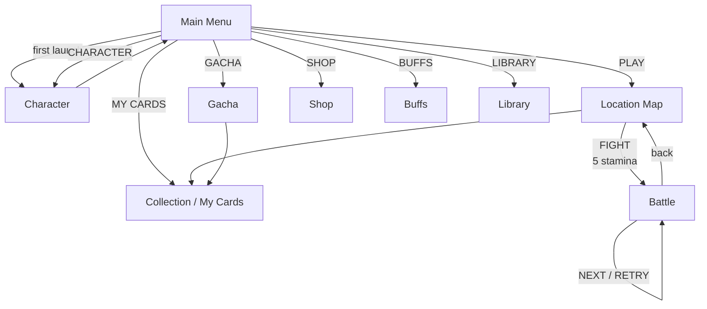

# Screens and flow

**Source of truth:** `Assets/Scripts/Data/GameSession.cs` (scene names), `Assets/Scripts/UI/*Screen.cs`,
`Assets/Editor/AniGameSetup.cs` (scene builder)

There are 9 scenes, one per screen, and each is driven by one `*Screen.cs` script. The scenes are **generated
by code** (**Tools › AniGame › Steps › 5. Build Scenes**) through `UIFactory`, so the objects are real and
editable. But rebuilding the scenes overwrites manual edits. See [architecture](../tech/architecture.md#ui).

## Navigation

Every scene change goes through `GameSession.LoadScene` → `ScreenFader`: a slanted pink and purple panel
sweeps across the screen, the next scene loads behind it, and the new screen's panels slide in.

## Screens

| Screen | Scene | Purpose | Key actions |
|---|---|---|---|
| **Main Menu** | `MainMenu` | Hub. Shows your builds and currencies. Shows save warnings once (for example after a tampered save) | PLAY, MY CARDS, GACHA, SHOP, BUFFS, LIBRARY, CHARACTER; SAVE DATA panel: export / import / open folder / reset save; QUIT |
| **Character** | `Character` | Create (first launch) or edit your character: name (≤20 characters) and picture (import from the PC / a path / a URL, or pick a built-in anime portrait) | Save; cards preview the change live |
| **Location Map** | `LocationMap` | Locations list (left), floors of the chosen location (middle), the floor's enemy and rewards (right) | Choose a build slot, FIGHT (5 stamina) |
| **My Cards** | `Collection` | A large showcase of the chosen card or slot build, an upgrade panel, a filterable collection grid, the 3 build slots | Reroll stats / element / talent (preview), SAVE TO SLOT, fuse, auto merge, God Orb, dismantle, lock; click the card's name to EDIT CARD (own name and picture) |
| **Gacha** | `Gacha` | The 6 packs with their odds | Open a pack (reveal animation) |
| **Shop** | `Shop` | The orb shop | Buy Fusion / Element / Talent Orbs in any quantity |
| **Buffs** | `Buffs` | 22 permanent buffs in 4 groups | Buy |
| **Library** | `Library` | A searchable in-game guide, **built from the live rules** so it is never out of date | Search; topics: Elements, Items, Stats & Rarity, Fusion, Rerolls, Talents, Buffs, Stamina & Rewards, Gacha, Battle, Save Data |
| **Battle** | `Battle` | Plays the auto-battle back: card views, HP/mana bars, damage numbers, talent banners, battle log | Speed 1×/2×/4×; result screen with rewards; NEXT floor, RETRY (5 stamina), back |

`SampleScene` is still in the build settings but nothing uses it ([known issues](../project/roadmap.md#known-issues)).

## Shared UI

| Component | What it does | Script |
|---|---|---|
| Currency bar | Gold, diamonds, the 3 orbs and stamina at the top of each screen, refreshed every second | `UI/CurrencyBar.cs` |
| Card view | A large card: art, rarity frame (with effects at high rarity), element, power, bars, stats, talent, status line. Fixed 400×620, scaled to fit | `UI/CardView.cs` |
| Card tile | The small card used in grids | `UI/CardTile.cs` |
| Tooltips | Hover tooltips on stats, talents, items | `UI/UITooltip.cs`, `UI/TooltipTrigger.cs` |
| Button effects | Hover and press animation, click sound | `UI/UIButtonFx.cs` |
| Background | Animated anime background: gradient, light rays, halftone dots, sakura petals, sparkles | `UI/AnimeBackground.cs` |
| Transitions | Scene wipe and panel intro animations | `UI/Fx/ScreenFader.cs`, `UI/Fx/ScreenIntroRunner.cs` |
| Effects | Sparks, confetti, slashes, flashes, shakes, slow motion, … | `UI/Fx/UIFx.cs` and the `Fx*` components |

## UX rules already in the build

- **Rerolls never open a popup.** The new roll shows on the card and stays unsaved until SAVE TO SLOT, so you
  can keep rolling.
- **Choose a build slot before every fight** (doc 10). The map shows which slot will fight.
- **A defeat suggests what to do next:** a counter element for this enemy, reroll or fuse, or try another slot.
- **Actions that can't be undone ask twice**, for example "CLICK AGAIN TO CONFIRM" on Reset Save.
- **The game explains missing requirements:** every action that can fail returns a sentence such as
  "Needs 3 Fusion Orbs" or "GOD rarity is locked: buy the New Generation buff", and the UI shows it.
